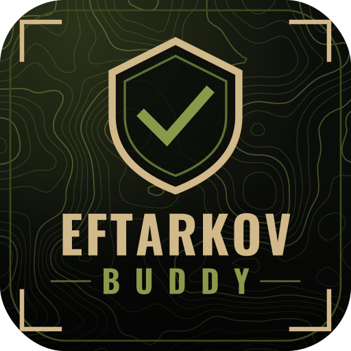
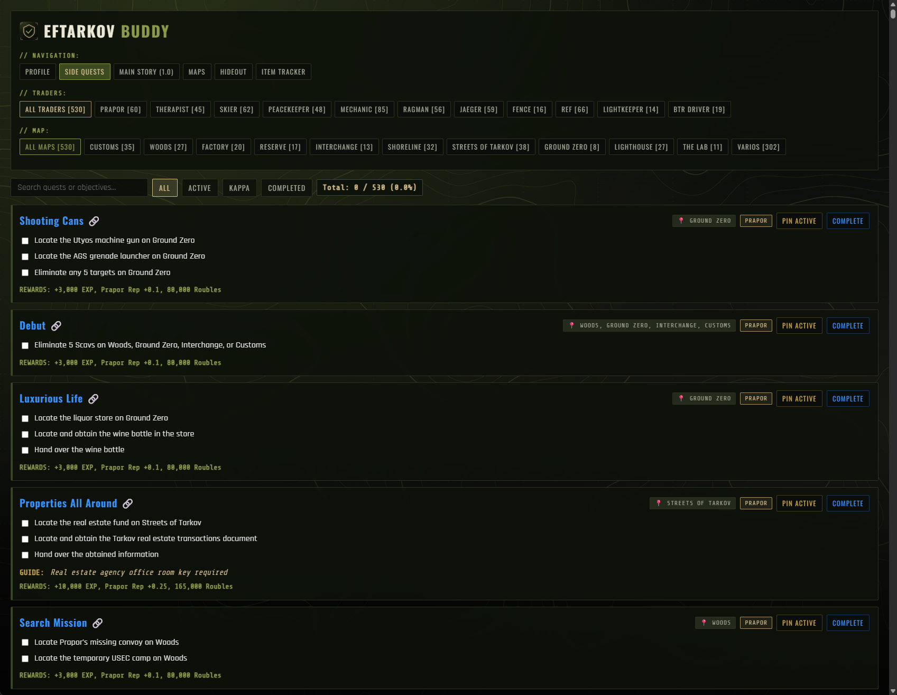
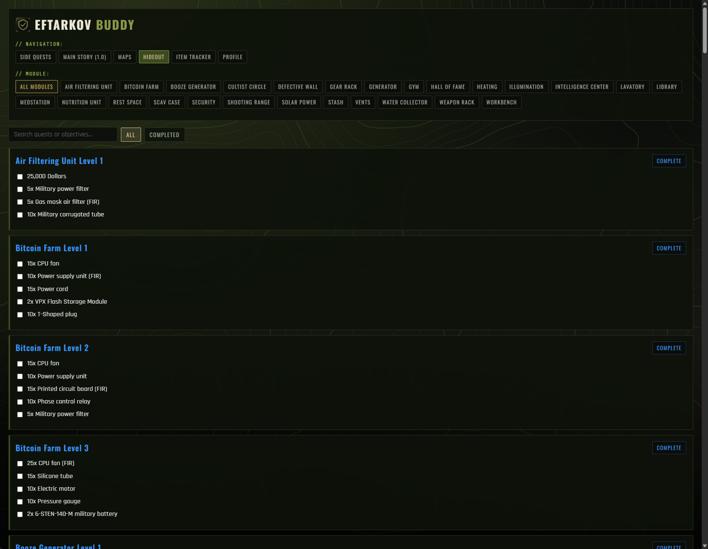
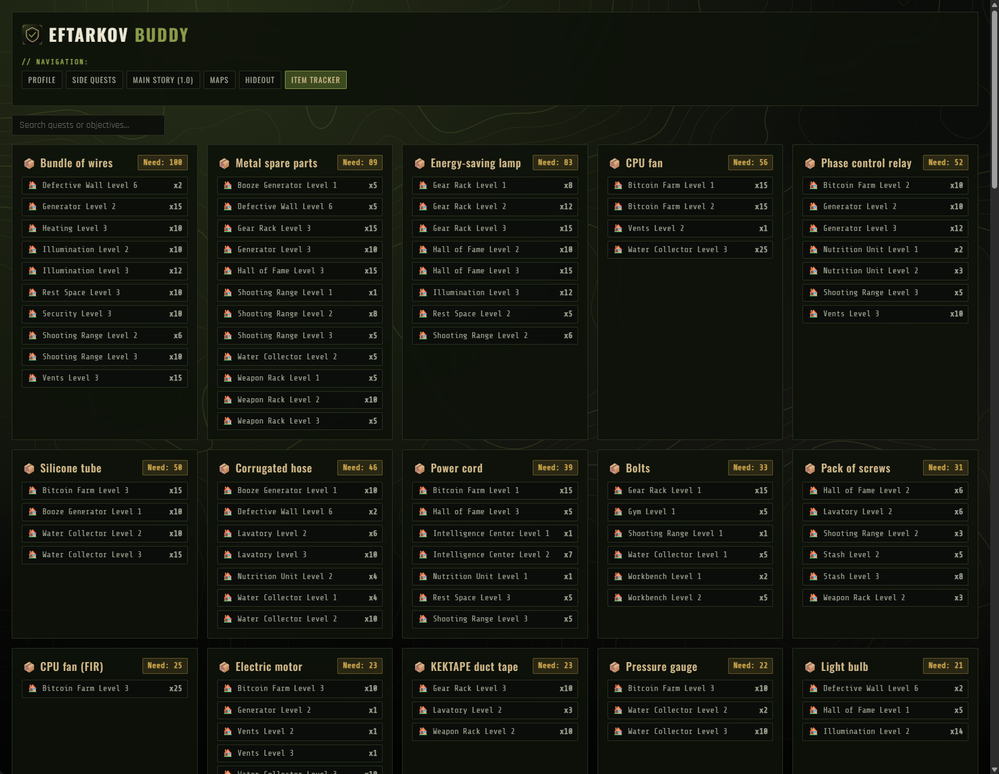
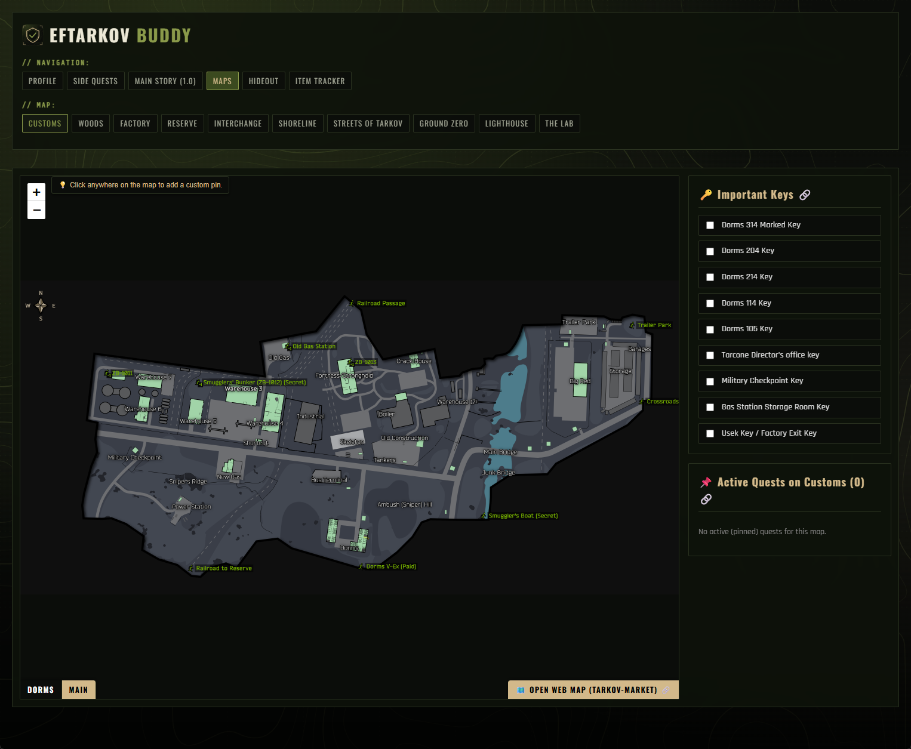
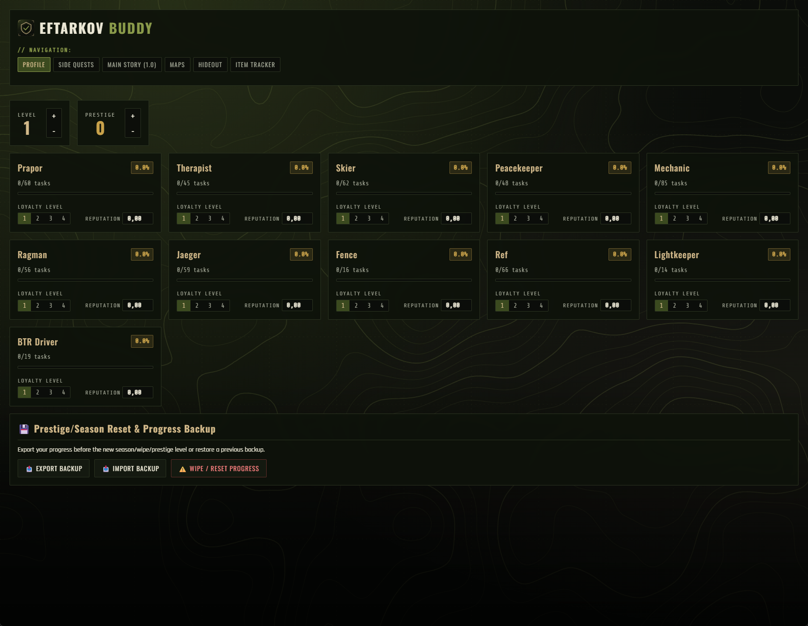

# EFTARKOV BUDDY

**Know your next objective before you load in.**

`> OPERATION: PREP // v1.0.2 ONLINE`

 

---

**EFTarkov Buddy** is a fast, lightweight desktop companion for *Escape From Tarkov*. Built with **Tauri v2** and **Rust**, it helps PMC operatives track quest progression, story chapters, hideout module requirements and physical item needs in real time.

Stop alt-tabbing to a dozen wiki pages: your progress, requirements and maps live in a single tactical dashboard.

 

## `// 01` — CAPABILITIES

| | Module | What it does |
|:-:|---|---|
| 📜 | **Quest & Main Story Tracker** | Complete database of side quests and 1.0 main story chapters, organized by trader and by map. |
| 🏠 | **Hideout Module Manager** | Full control of module upgrade paths and requirements to level up your hideout efficiently. |
| 📦 | **Smart Item Tracker** | Automatically calculates every physical item needed for pending quests and hideout upgrades, filtering out objective action verbs. |
| 🗺️ | **High-Res Interactive Maps** | Detailed map locations alongside essential key lists, with direct links to the official Tarkov Wiki. |
| 👤 | **PMC Profile & Trader Progression** | Track your level, loyalty levels and reputation across all traders in one centralized dashboard. |
| 💾 | **Backups & Wipe / Prestige Reset** | Export and import your progress as JSON backups, or trigger a full wipe reset for a new season. |

 

## `// 02` — RECON

<table>
  <tr>
    <td width="50%"> <b>Dashboard</b> — PMC profile and overview</td>
    <td width="50%"> <b>Quests</b> — by trader and by map</td>
  </tr>
  <tr>
    <td width="50%"> <b>Hideout</b> — module requirements</td>
    <td width="50%"> <b>Items</b> — everything you still need</td>
  </tr>
  <tr>
    <td width="50%"> <b>Maps</b> — locations and key lists</td>
    <td width="50%"> <b>Traders</b> — loyalty and reputation</td>
  </tr>
</table>

 

## `// 03` — LOADOUT

Your PC is already busy running Tarkov. Buddy stays small, quick and out of your way.

| Layer | Technology |
|---|---|
| **Frontend** | HTML5 · Modern CSS · Vanilla JavaScript |
| **Backend** | Rust |
| **Framework** | Tauri v2 |
| **Data** | Lightweight local JSON databases |
| **Platform** | Windows (x64) |

 

## `// 04` — DEPLOYMENT

1. Go to the [**Releases**](../../releases) section of this repository.
2. Download the latest installer: `EFTarkov_Buddy_1.0.2_x64-setup.exe`
3. Run the installer and follow the setup wizard.
4. Launch **EFTarkov Buddy** and start tracking your raid goals.

 

## `// 05` — BACKUPS

Your progress can be exported to a JSON file and imported again at any time, so you can keep a safe copy or move to another machine. When a new season starts, use the wipe / prestige reset to start clean.

---

> ### ⚠ DISCLAIMER & CREDITS
> **EFTarkov Buddy** is an unofficial, fan-made application. It is not affiliated with, endorsed by, or sponsored by Battlestate Games. *Escape From Tarkov* and all related assets, names, and trademarks belong to **Battlestate Games**.
> The tactical maps used within this application have been sourced from [Tarkov Market](https://tarkov-market.com/). All credits for the maps belong to their respective creators and platform.
